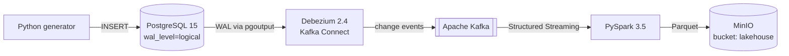
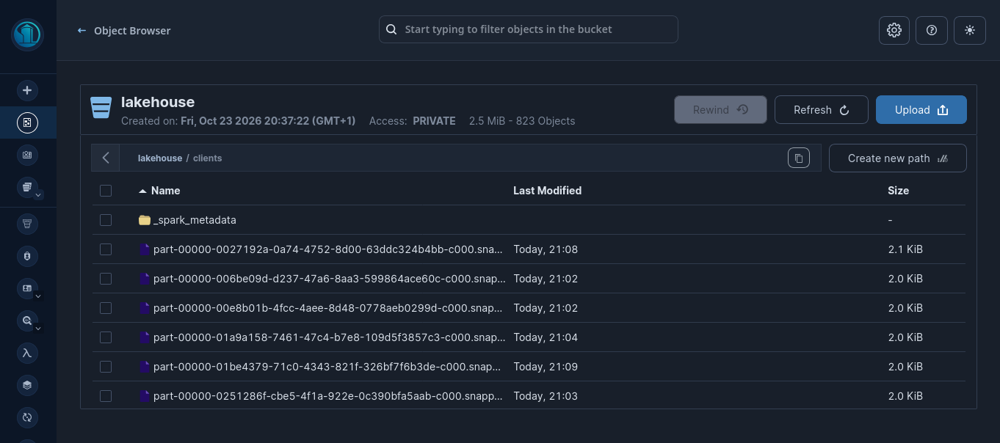

# Real-Time CDC Pipeline: PostgreSQL → Debezium → Kafka → Spark → MinIO


A streaming pipeline that captures row-level changes from PostgreSQL with **Change Data Capture**, transports them through Kafka, and lands them as **Parquet files in S3-compatible object storage** using Spark Structured Streaming. The whole stack runs locally with one `docker compose up`.

<!-- TODO: add a short GIF or screenshot of the pipeline running (generator + Spark + MinIO) -->
<!--  -->

## Why this project

Batch exports to a data lake are always stale and put load on the source database. CDC reads the database's write-ahead log instead, so changes reach the lake within seconds and the production tables are never queried. This project is a minimal, reproducible version of that pattern.

## Architecture



1. A Python script continuously inserts mock transactions into PostgreSQL.
2. Debezium reads the write-ahead log (`pgoutput`) and publishes one event per row change to Kafka.
3. A PySpark Structured Streaming job consumes the topic, extracts the `after` state of each row and writes it as Parquet to MinIO.

## Tech stack

| Layer | Tool |
|---|---|
| Source database | PostgreSQL 15 (logical replication enabled) |
| CDC | Debezium 2.4 on Kafka Connect |
| Broker | Apache Kafka (KRaft, no Zookeeper) |
| Processing | PySpark 3.5.0, Structured Streaming |
| Storage | MinIO (S3-compatible), Parquet + Snappy |
| Infrastructure | Docker Compose |

## Repository structure

```text
.
├── data-generator/      # Python script that produces mock transactions
├── docker/              # docker-compose.yml (PostgreSQL, Kafka, Debezium, MinIO)
├── spark_streaming.py   # Kafka → Parquet streaming job
└── README.md
```

## Getting started

### Prerequisites

- Docker and Docker Compose
- Python 3.9+
- Java 8, 11 or 17 (required by Spark 3.5)

### 1. Start the infrastructure

```bash
cd docker
docker compose up -d
docker compose ps        # all four services should be "running"
```

### 2. Register the Debezium connector

```bash
curl -i -X POST -H "Accept:application/json" -H "Content-Type:application/json" \
  localhost:8083/connectors/ -d '{
  "name": "postgres-cdc-connector",
  "config": {
    "connector.class": "io.debezium.connector.postgresql.PostgresConnector",
    "database.hostname": "postgres",
    "database.port": "5432",
    "database.user": "postgres",
    "database.password": "password",
    "database.dbname": "lakehouse",
    "topic.prefix": "lakehouse_cdc",
    "plugin.name": "pgoutput"
  }
}'
```

Check that it is running: `curl localhost:8083/connectors/postgres-cdc-connector/status`

### 3. Create the MinIO bucket

Open the console at <http://localhost:9001> (`admin` / `password123`) and create a bucket named **`lakehouse`**.

### 4. Run the pipeline

```bash
python -m venv venv && source venv/bin/activate
pip install pyspark==3.5.0
```

Terminal 1, the data generator:

```bash
python data-generator/main.py
```

Terminal 2, the streaming job:

```bash
python spark_streaming.py
```

### 5. Verify

Browse the `lakehouse` bucket in the MinIO console: `.snappy.parquet` files appear under `clients/` while the job runs.



<!-- Optional: add a clean `docker compose ps` screenshot as docs/img/docker-ps.png, then uncomment the next line -->
<!--  -->

## What a change event looks like

Debezium wraps every row change in an envelope. The job keeps the `after` field:

```json
{
  "before": null,
  "after": { "id": 1, "...": "row columns" },
  "op": "c",
  "ts_ms": 1760000000000
}
```

`op` is `c` (create), `u` (update) or `d` (delete).

## Design decisions and limitations

- **Logical replication, not polling:** `wal_level=logical` and the `pgoutput` plugin let Debezium stream changes without queries on the source tables.
- **Parquet on object storage:** columnar, compressed and readable by Spark, Trino, DuckDB and pandas.
- **Current scope:** the job writes the `after` state of each event, so inserts are fully captured. Updates are appended as new rows and deletes are not applied. This is a data lake landing zone, not yet a table format with ACID guarantees.
- **Many small files:** every micro-batch writes its own tiny Parquet file (about 2 KiB each; 800+ files for 2.5 MiB in one run). A longer trigger interval or a compaction step (for example Iceberg's `rewrite_data_files`) would fix this.
- **Local credentials:** the passwords in this README are for the local demo only. Do not reuse them anywhere real.

## Roadmap

- [ ] Replace raw Parquet with **Apache Iceberg** tables for ACID, schema evolution and time travel
- [ ] Apply updates and deletes with `MERGE INTO`
- [ ] Query the tables with **Trino**, model marts with **dbt**
- [ ] Compact small files (longer trigger interval, then Iceberg compaction)
- [ ] Unit tests for event parsing and a GitHub Actions workflow
- [ ] Measure and document throughput and end-to-end latency

## Clean up

```bash
# Ctrl+C in both Python terminals, then:
cd docker && docker compose down -v
```

## Author

**Kaoutar Attaf**, Data Scientist / Data Engineer
[Portfolio](https://attafkaoutar.netlify.app/) · [LinkedIn](https://www.linkedin.com/in/kaoutar-attaf-95b487202)
